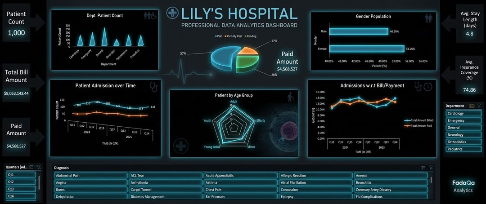

# LILY'S HOSPITAL GENERAL PERFORMANCE DASHBOARD & HEALTHCARE ANALYTICS REPORT

## INTRODUCTION
Managing modern healthcare facilities requires accurate, real-time tracking of patient care quality, resource allocation, and revenue cycle stability. This project presents an end-to-end data analytics dashboard engineered in Microsoft Excel for Lily's Hospital. 
By consolidating patient demographics, admission metrics, length of stay, and billing performance into a single interactive dark-themed interface, this solution transforms raw administrative logs into strategic clinical and executive intelligence.

## ABOUT THE DATASET
The operational dataset underlying this project contains multi-dimensional records spanning 1,000 patient encounters across six core medical departments between Q1 2024 and Q4 2025. Key attributes captured in the data pipeline include:
- **Patient Demographics**: Unique patient identity codes and categorized age groups (Minor, Youth, Young Adult, Adult, Elderly).
- **Departmental Distribution**: Cardiology, Emergency, General Medicine, Neurology, Orthopedics, and Pediatrics.
- **Clinical Metrics**: Date of admission, length of hospital stay (in days), and primary clinical diagnosis (e.g., Angina, Appendicitis, Dehydration, Asthma).
- **Financial Identifiers**: Total amount billed ($8,053,143.44 aggregate), total amount paid ($4,568,527 aggregate), insurance coverage percentages, and payment collection status (Paid, Partially Paid, Pending).

**Data Source**: To view and access this dataset, [Click here](https://docs.google.com/spreadsheets/d/1zOflKibAC4ORdmkNPdS2MCg0LU5L0qdY/edit?usp=drivesdk&ouid=116961276628608901832&rtpof=true&sd=true)

## PROBLEM STATEMENT
Hospital leadership faced operational challenges in evaluating patient throughput and revenue recovery across clinical units. Specifically, administrative bottlenecks included:
1. **Fragmented Reporting**: Lack of centralized visibility into patient admission trends across quarterly timeframes.
2. **Capacity Management**: Inability to pinpoint departments with elevated patient load or prolonged lengths of stay impacting bed capacity.
3. **Financial Leakage**: A high ratio of pending and partially paid patient bills without granular breakdown by diagnosis or insurance coverage rates.
4. **Goal**: The objective of this dashboard project is to aggregate these disparate data streams, identify operational bottlenecks, and provide interactive filtering for data-driven decision-making.

## DASHBOARD VISUALIZATION
Below is the completed, high-resolution interactive dashboard created for Lily's Hospital:

## INSIGHTS & KEY FINDINGS
Through rigorous dynamic query modeling and pivot table evaluation, several key performance insights were uncovered:
1. **Patient Throughput & Capacity**
- *Patient Distribution*: A total of 1,000 patients were evaluated across the monitoring period. The General Medicine and Emergency departments experienced the highest overall patient volumes, while Pediatrics and Orthopedics maintained steady baseline loads.
- *Length of Stay (LOS)*: The average length of stay across all departments stands at 4.8 days, indicating standard acute care recovery cycles but highlighting opportunities for outpatient transfer optimization.
2. **Financial & Revenue Cycle Performance**
- *Revenue Collection*: Out of $8,053,143.44 total billed medical charges, $4,568,527 (56.7%) has been realized as paid revenue, leaving a substantial portion outstanding.
- *Payment Status Distribution*: Payment status distribution reveals that 57% of bills are Fully Paid, 26% are Pending collection, and 17% remain Partially Paid.
- *Insurance Coverage*: Average insurance coverage across patient cases reached 74.86%, demonstrating strong third-party payer integration, though out-of-pocket patient balances account for the majority of pending receivables.
3. **Demographic & Clinical Patterns**
- *Age Group Radar Analysis*: Patient distribution by age group shows balanced utilization across Adults, Young Adults, and the Elderly, with distinct clinical diagnosis spikes in acute abdominal conditions and cardiac monitoring.
- *Admissions Trend*: Quarterly trend analysis (2024 Q1 - 2025 Q4) demonstrates stable patient admission numbers (ranging from 106 to 141 admissions per quarter), with peak admissions occurring during Q3 2024.

## STRATEGIC RECOMMENDATIONS
Based on the data insights generated by the dashboard, the following actionable strategies are recommended for hospital administration:
1. **Optimize Receivables & Revenue Recovery**: Implement automated patient balance reminders and streamline insurance claim submissions for the 26% pending payment pool to accelerate revenue recovery.
2. **Resource Reallocation for High-Volume Units**: Allocate additional nursing staff and bed capacity to General Medicine and Emergency units during Q3 peak intake periods identified in the time-series trends.
3. **Reduce Average Length of Stay (LOS)**: Establish clinical care pathways for common inpatient diagnoses to reduce the average length of stay from 4.8 days down to a targeted 4.0 days, increasing bed turnover efficiency.
4. **Insurance & Out-of-Pocket Support**: Establish financial counseling services for uninsured or partially covered patients prior to discharge to establish structured payment plans.

## CONCLUSION
The Lily's Hospital Performance Dashboard successfully translates complex healthcare administration and billing data into a clear, centralized decision-making platform. By establishing clear visibility over patient throughput, departmental load, and revenue recovery metrics, this project enables hospital executives to enhance patient care outcomes while safeguarding financial sustainability. The accompanying Excel artifact serves as a scalable model for healthcare data analytics and clinical performance tracking.

